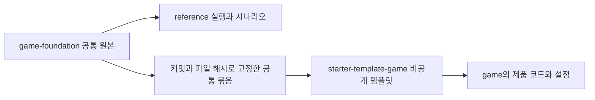

# 게임 공통 기반과 템플릿 분리

사용자가 2026-10-25 이 설계를 구현하고 검증한 뒤 PR 병합까지 진행하도록 요청했다. 대화에 제공된 「게임 템플릿과 공개 레퍼런스의 폴더 구조」가 승인 범위다. 기존 소프트 어드벤처 1.0.0 방향을 유지한다.

공통 원본은 `godot/addons/seorilabs_game`, 플랫폼은 정식 SDK v1.0.0 고정본이다. reference의 여우, 하늘섬, 상품과 대역은 공통 원본에서 참조하지 않는다. 장면과 전용 그림을 기능 옆에 두고 순수 규칙, 유스케이스, 포트와 구현을 분리한다. 시작부터 안내, 별 3개 수집, 결과와 저장, 로비와 재실행을 검수한다. 세 홈, 공통 메뉴와 기존 오류, 지연 응답 계약을 유지한다.

이동한 코드는 기존 계약 검사와 실제 입력 여정을 회귀 검증한다. 새 묶음 검증은 변조와 누락을 실패시키는 검사부터 추가했다. 그림과 라이선스 이동은 파일 해시 대조로 확인한다. 출력은 build에만 쓰며 추적 소스를 바꾸지 않는다.

인수조건은 AC-01 독립 실행, AC-02 공통과 제품 참조 분리, AC-03 출처와 해시 고정, AC-04 기존 서비스 계약, AC-05 작은 화면과 언어, 큰 글자, 드래그와 키보드, AC-06 대역 export 제외와 소스 불변, AC-07 템플릿 초기화, AC-08 수동 Pages와 PR 병합이다.

테스트는 같은 폴더의 L3 개발 환경 계획을 따른다. 독립 기능과 화면 검수 3회는 각 실행 전에 계획을 남긴다. 실제 Godot 렌더와 headless 입력을 사용하며 기기, 실제 결제, 운영 서비스와 마켓 출시는 제외한다. `release: null`이다. 중앙 검증기의 마켓 차단은 보존한다. 코드 MIT, 예제 그림 CC0, 글꼴 OFL과 출처를 보존한다.

적용은 공통 원본 검수, 동일 묶음의 템플릿 설치, 스킬 안내 전환 순서다. 이전 코드로 복원해야 하면 이전 Git 커밋의 고정 묶음을 설치한다. 사용자 수정이 있는 공통 파일은 덮어쓰지 않고 중단한다. 새 버전 태그와 기존 게임 이관은 하지 않는다.
