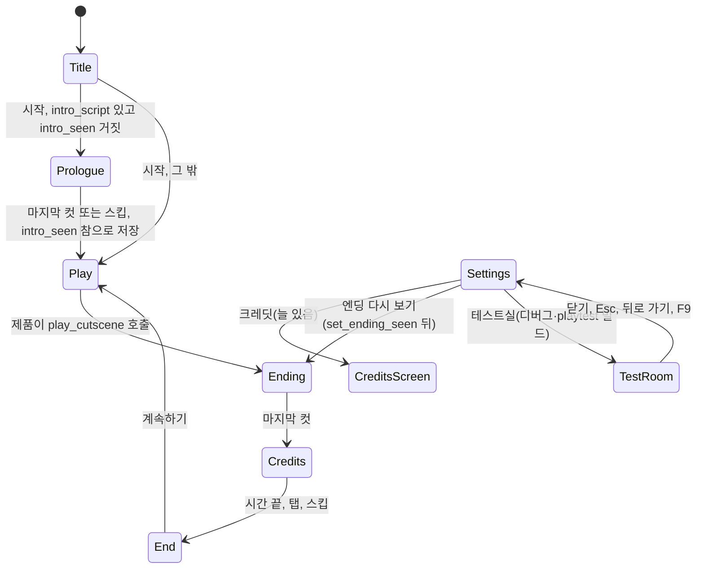

# 컷신 재생기, 크레딧, 테스트실 (계약 1.2.0)

- 설계 ID·기준 커밋: `2026-11-26-cutscene-test-room`, 기준 main `e7e905df9aefe8f50f917ba103f6bcdcf240f60e`
- 상태: 승인된 상위 설계의 구현. 상위 설계는 agent-config `docs/design/2026-11-26-game-skill-system-v2/design.md`(2026-11-26 승인, agent-config ④ PR로 병합 예정)의 "컷신 재생기", "아웃게임 연결", "테스트실", "계약 1.2.0", "품질 요구사항" 절과 AC-8~AC-14다.
- 승인 근거: 2026-11-26 사용자가 상위 설계 선택 질문에서 "컷신·테스트실은 이번에 공용화"와 "승인, 병합까지 진행"을 골랐다. 이 문서는 상위 설계의 범위를 넘는 기능을 더하지 않고, 구현 중 정한 세부 결정만 적는다.
- 테스트 계획: [test-plan.json](test-plan.json). L3(공통 묶음 `addons/**`), 개발 환경, redesign(새 화면 3종), 출시 없음(`release: null`), 기기 사용 없음
- 원본 구현: smash-and-slice `godot/src/views/cutscene_view.gd`, `godot/src/core/cutscenes.gd`, `godot/src/ui/settings_popup.gd`의 시연 영역, `godot/src/main.gd`의 `_on_sandbox_action`, `_apply_snapshot`, `_replay_cutscene`(읽기 전용 참고)

## 목적·범위·근거

외부 기획자가 smash-and-slice에서 요구한 프롤로그와 엔딩, 크레딧과 AI 생성 콘텐츠 고지, 테스트실은 상위 설계가 "완성작 구성요소"(CMP-01, CMP-02, CMP-14)로 정했다. smash-and-slice는 이 셋을 게임 코드에 직접 묶어 만들었다. 컷신 화면은 게임의 `AudioManager`, `I18n`, `GameRules.fmt`, 컷 상수와 "SMASH & SLICE!" 제목·색에 묶여 있고, 테스트실은 설정 팝업 안에 있어 공개 웹 빌드에서도 F9로 열린다. 새 게임이 같은 일을 반복하지 않도록 공통 기반에 데이터만 넣으면 되는 부품으로 옮긴다.

| 구분 | 내용 |
|---|---|
| 포함 | `ui_kit/cutscene_player`(크레딧 단계 포함), `flow/outgame_main`·`flow/state`의 프롤로그·크레딧·엔딩 다시 보기·테스트실 연결, `dev/test_room`, 레퍼런스 map 제품의 시연 데이터와 CC0 컷 그림, `ui_kit_probe` 확장과 `dev_probe`, 여정 시나리오 3개, 계약 1.2.0, 웹 export preset의 `dev/**` 제외 |
| 제외 | 소비 게임 전환(starter-template-game은 다음 PR), smash-and-slice 이전, PC 설정 공용화, 음악 시스템(컷신은 효과음·음악 포트만 부른다), 마켓 출시, 기기 사용 |

## 사용자 흐름·화면 상태



| 화면 | 상태와 입력 |
|---|---|
| 컷신 | `idle → cut → credits → end`. 탭·클릭·Space·Enter는 다음 컷, Esc·뒤로 가기·스킵 버튼은 스킵. `lock_skip` 컷은 둘 다 무시하고 시간이 다 되면 넘어간다. 다시 보기(`{replay: true}`)는 잠금을 푼다. 크레딧이 있는 스크립트의 스킵은 끝 화면(계속하기)으로, 없으면 바로 끝난다. 앱·창 포커스를 잃으면 같은 컷에서 멈추고 돌아오거나 입력이 오면 이어 간다 |
| 설정의 크레딧 | 제품 `credits.sections` 뒤에 글꼴 라이선스 구역. 제품 크레딧이 없어도 글꼴 라이선스는 보인다 |
| 테스트실 | 봐줄 점, 행동(그룹별), 플레이 시점 프리셋, 연출 다시 보기. 덮어쓰기는 첫 누름에 "한 번 더 누르면 적용"으로 바뀌고 두 번째에 적용된다. 다른 버튼을 누르거나 닫으면 무장이 풀린다. 결과 줄은 두 줄 고정 높이다 |

## 구조·책임·의존성

| 파일 | 책임 |
|---|---|
| `addons/seorilabs_game/ui_kit/cutscene_player.gd`, `.tscn` | 컷 재생, 크로스페이드, 줌·이동·흔들림·번쩍임·비네트, 타이틀 카드, 카운트업, 효과음 요청, 크레딧 롤, 끝 화면. HUD의 Ftue 층(40)에 붙는다 |
| `addons/seorilabs_game/dev/test_room.gd`, `.tscn` | 테스트실 화면과 등록 API. `class_name`이 없고 호스트가 런타임 `load()`로만 연다. Popup 층(20)에 붙고 막힌 이유는 Toast 층(30)에 뜬다 |
| `addons/seorilabs_game/flow/outgame_main.gd` | 첫 시작 프롤로그, `play_cutscene`, `set_ending_seen`, `credit_sections`, 설정 항목(크레딧, 엔딩 다시 보기, 테스트실), 노출 게이트와 F9 |
| `addons/seorilabs_game/flow/state.gd` | 선택 키 `intro_seen` 읽기(`intro_seen()`)와 저장(`mark_intro_seen()`) |
| `reference/config/map.json`, `reference/assets/cutscene/*.svg` | 레퍼런스 map 제품만 가진 프롤로그 3컷, 엔딩 2컷과 크레딧, 제품 크레딧(AI 고지 포함) |
| `reference/bootstrap/main.gd` | `apply_product(product)`로 제품 설정 적용, `test_room_setup` 예제 |

의존 방향은 그대로다. 공통 코드는 `res://reference/`를 참조하지 않고(`check_architecture.py`, `test_structure.py`), 테스트실을 `preload`하지 않는다(`test_export_presets.py`).

## 데이터·인터페이스·실패 처리

```text
cutscene_player
  play(script: Dictionary, options := {replay: bool})
  script = {id, cuts: [{art, sub: [en, ko], dur, zoom: [시작, 끝], pan: [[x, y], [x, y]], sfx: [[t, key, db]],
                        lock_skip, flash: [t, 길이], shake: [t, 세기], vignette, title: true | [en, ko],
                        count_up: {to}, music_db}],
            credits: {sections: [[[en, ko], [en, ko]]], dur}}     # credits는 선택
  signal finished(skipped: bool), signal cut_changed(index: int)
  state() -> "idle" | "cut" | "credits" | "end", can_skip(), current_cut() -> int, request_next(), request_skip()
  주입: audio(play_cue, duck_music, sfx_enabled; null이면 무음), text(en, ko), number_format(int), art_loader(path),
        title_text, colors, ui_scale
  관찰: missing_art(찾지 못한 그림 경로), cue_log(요청한 효과음 키), paused

test_room
  register_action(id, label_pair, callable, {confirm: "none" | "double_tap", group: [en, ko]})
  register_snapshots([{id, label_pair, minutes}], apply: Callable(snapshot))
  register_replay(id, label_pair, script)
  set_notes([[en, ko] | String])
  Callable 반환: {ok, message_pair, blocked_reason_pair}
  주입: text, layers(HudLayers), play_cutscene(script, options), ui_scale
  open(), close(), toggle(), is_open(), result_text()

outgame_main
  intro_script, credits, ending_script, test_room_setup: Callable(room)
  play_cutscene(script, options := {}) -> {ok, blocked_reason_pair}, set_ending_seen(seen), credit_sections() -> Array
  open_test_room(), test_room(디버그·playtest 빌드가 아니면 null), cutscene
```

- 본 기록: `intro_seen`은 `SAVE_VERSION`을 올리지 않는 선택 키다. `valid()`는 필수 키만 검사하므로 1.1.0 저장이 그대로 열리고, 1.1.0 빌드도 이 키가 있는 저장을 연다. 엔딩 본 기록은 제품 저장 소관이고 제품은 `set_ending_seen`으로 알리기만 한다.
- 그림 누락: 기본 `art_loader`는 `ResourceLoader.exists`가 참일 때만 `load`한다. 없으면 빈 배경과 자막으로 진행하고 `missing_art`에 경로를 남기며 `push_warning`만 쓴다. `check.py`는 `ERROR:` 줄을 실패로 보므로 `push_error`를 쓰지 않는다.
- 시간: `_process`에서만 흐르고 한 프레임을 0.1초로 자른다. 웹에서 탭을 숨겼다 돌아올 때 긴 delta 한 번에 컷이 건너뛰지 않는다.
- 입력 충돌: 재생 중 키 입력은 컷신이 `_input`에서 모두 처리해 아래 화면의 초점 버튼과 F9가 받지 않는다. 뒤로 가기 알림은 호스트가 `_back()`을 부르지 않고 컷신(스킵)과 테스트실(닫기)이 처리한다. 터치를 마우스로 흉내 내는 기본 설정에서 같은 탭이 두 번 넘어가지 않도록 터치 이벤트는 흉내가 꺼져 있을 때만 받는다.
- 막힌 행동: 테스트실 행동이나 다시 보기가 막히면(예: 판 진행 중) 저장을 바꾸지 않고 이유를 토스트로 알린다. 호스트의 `play_cutscene`은 재생 중이거나 컷이 없으면 막는다.
- 노출 게이트: `OS.is_debug_build()` 또는 `OS.has_feature("playtest")`이고 `ResourceLoader.exists("res://addons/seorilabs_game/dev/test_room.tscn")`일 때만 `load()`하고 F9와 설정 항목을 붙인다. 출시 export는 `exclude_filter`에 `addons/seorilabs_game/dev/**`를 넣어 파일 자체를 뺀다. 이 저장소의 웹 preset도 뺐다.
- 크레딧 글꼴 구역: `fonts/manifest.json`의 TTF마다 이름(파일 이름을 띄어 쓴 것), 같은 이름의 `-OFL.txt` 첫 줄(저작권), 라이선스 이름을 적는다. OFL 파일이 export에 없으면 저작권 줄만 빠진다.

## 품질 요구사항

- 기존 흐름 무변경: 프롤로그는 map 제품과 새 시나리오에만 있다. 기존 시작 직후 `play` 기대(`outgame_journey.gd`의 첫 플레이), `ui_navigation_probe`, `camp_probe`는 고치지 않고 통과한다. skyway, windharbor는 `introScript`, `endingScript`가 없다.
- 화면: 컷신, 크레딧, 테스트실이 390x844, 320x568, 844x390, 1280x720에서 잘리지 않고 글자가 읽힌다. 자막은 효과음 설정과 무관하게 보인다. 글자 크기는 짧은 변/390(0.9~1.4배)과 호스트 `ui_scale` 중 큰 값으로 키운다.
- 터치 목표: 새 버튼(스킵, 계속하기, 테스트실 닫기와 행동 버튼)은 모든 방향에서 56px 이상이다. 가로 캠프 검사(`camp_probe`)가 출력 트리의 모든 버튼에 56px을 요구한다.
- 출시 빌드: 테스트실 파일이 없어도 다른 스크립트가 깨지지 않는다(`class_name` 없음, `preload` 없음).
- 소비 게임 호환: 새 기능 ID `cutscene`, `credits`, `test_room`은 기능 목록에만 넣고 `check.py`의 `REQUIRED`·`UI_CHECKS`와 `validate_outgame.py`의 필수 동작에는 넣지 않는다. 기능 목록의 `core`는 거짓이다. 중앙 계약에서 `core`는 기기 하한의 대체 목록으로 쓰이는데, 세 기능은 제품이 고르는 선택 기능이다.

## 대안·주요 결정

| 결정 | 고른 것 | 고르지 않은 것과 이유 |
|---|---|---|
| 컷신 그림 노드 | 앞(Front)·뒤(Back) 노드 역할을 고정하고 그림과 변환만 뒤로 옮긴다 | 노드를 서로 바꾸기(원본 방식): 노드 이름과 역할이 어긋나 검사와 제품 코드가 헷갈린다 |
| 크레딧 형식 | 컷신 `credits.sections`와 설정 `credits.sections`를 같은 `[[제목, 본문]]` 형식으로 두고 `credit_sections()`가 글꼴 구역을 붙인다 | 설정 전용 형식: 엔딩 크레딧과 설정 크레딧이 따로 관리돼 고지가 어긋난다 |
| 카운트업 시간 | 컷 시작 0.6초 뒤부터 2초, 움직임 줄이기에서는 바로 최종 값 | 컷마다 시간 지정: 상위 설계의 `count_up: {to}` 밖의 필드다 |
| 스킵의 끝 | 크레딧이 있으면 끝 화면(계속하기), 없으면 바로 끝 | 늘 바로 끝: 엔딩 뒤 크레딧 고지를 한 번도 못 볼 수 있다(원본도 엔딩 스킵은 끝 화면으로 갔다) |
| 테스트실 층 | Popup 층(20), 토스트는 Toast 층(30), 컷신은 Ftue 층(40) | System 층: 막힌 이유 토스트가 테스트실 아래로 깔린다 |
| 다시 보기 중 테스트실 | 다시 보기를 시작하면 테스트실을 닫는다 | 열어 둔 채 재생: 컷신이 위를 덮어 닫기 버튼에 닿을 수 없다 |
| 글꼴 라이선스 수 | `fonts/manifest.json`의 TTF 4종(Jua, Fredoka, Noto Sans KR, Noto Sans Mono)을 모두 적는다 | 상위 설계 AC-10의 "3종": 목록에 실제로 4종이 있어 하나를 빼면 고지가 누락된다. 여정은 목록의 모든 TTF와 3종 이상을 확인한다 |
| 레퍼런스 엔딩 | map 제품에 엔딩 2컷과 크레딧을 넣고, 엔딩 도달은 테스트실 예제 행동("엔딩 도달")으로 시연한다. 본 기록은 레퍼런스 메모리에만 둔다 | 엔딩 없이 크레딧만: 크레딧 롤과 끝 화면, 다시 보기 항목을 실제 화면으로 검수할 수 없다 |
| 컷 그림 | 코드로 직접 그린 SVG 5장(CC0) | 이미지 생성: 검수 대상은 재생기이고, 생성 비용과 라이선스 기록이 늘어난다 |
| 검사의 시계 | probe와 여정은 컷신 시계를 `_process(0.1)`로 직접 넘긴다 | 실제 시간 대기: 렌더링 창이 포커스를 잃으면 멈춰 캡처가 흔들린다 |

## 인수조건·테스트·검수

상위 설계의 조건 ID를 그대로 쓴다.

| 조건 ID | 통과 기준 | 방법·환경 | 시작 상태 | 증거 |
|---|---|---|---|---|
| AC-8 | 다음 컷, 잠긴 컷의 스킵·탭·Esc·Enter 무시, 크레딧 단계, 카운트업 표기 주입, 그림 누락 시 진행, 포커스 정지 후 같은 컷 재개, 한 프레임 0.1초 상한, 효과음 꺼짐에도 자막 표시가 motion과 reduced 두 번 통과한다 | `ui_kit_probe`(check.py), headless | 격리 노드 | `build/<out>/ui-kit.json` |
| AC-9 | map 첫 시작에 프롤로그, 스킵하면 플레이, 저장 버전 그대로 `intro_seen` 저장, 재실행하면 프롤로그 없이 플레이. skyway, windharbor와 기존 시나리오는 1.1.0과 같다 | 여정 `map-prologue-first-start-once`(재실행 포함), 기존 10개 시나리오 | 빈 격리 저장 | `journey.json` |
| AC-10 | 설정 크레딧에 제품 문구, AI 고지, 글꼴 라이선스(목록의 TTF 전부)가 보이고 제품 크레딧이 없는 skyway도 글꼴 라이선스가 보인다. `set_ending_seen(true)` 뒤 "엔딩 다시 보기"가 생기고 다시 보기 뒤 저장 바이트가 같다 | 여정 `settings-credits-and-ending-replay` + 캡처 | 격리 저장 | `journey.json`, 캡처 |
| AC-11 | 디버그 실행에서 F9로 테스트실이 열리고, 시점 적용은 두 번 눌러야 하며, 결과 줄 높이가 고정이고, 연출 다시 보기 뒤 저장 바이트가 같고, 막힌 행동은 토스트를 띄우고 저장을 바꾸지 않는다. 재생 중 F9는 무시된다 | `dev_probe`(check.py) + 여정 `debug-test-room` | 격리 저장 | `dev.json`, `journey.json` |
| AC-12(기반 몫) | 이 저장소의 웹 preset이 `addons/seorilabs_game/dev/**`를 빼고, 공통 코드가 테스트실을 preload하지 않는다 | `tools/test_export_presets.py` + 로컬 `--export-pack` 파일 목록 | 후보 커밋 | 테스트 로그, 파일 목록 |
| AC-13 | 컷신, 크레딧, 테스트실이 4개 크기에서 잘리지 않고 글자가 읽힌다 | `check.py --capture --size` 390x844, 320x568, 844x390, 1280x720 + 독립 검수 3회 | 레퍼런스 | 캡처, `docs/qa/cutscene-test-room-review/round-N.md` |
| AC-14(기반 몫) | 1.2.0 묶음이 1.1.0 위에 설치되고 반대는 거부된다. 1.2.0 아래 제품 스킨 계약 1.1.0이 통과한다 | `tools/test_bundle.py`, `tools/test_ui_contract.py` | 임시 폴더 | 테스트 로그 |

- TDD: 구현 전에 `ui_kit_probe`의 컷신 검사(재생기 장면 없음으로 실패), `dev_probe`(장면 없음으로 실패), Python 테스트 6개(파일 집합, 1.2.0 설치, 스킨 계약, preset 제외)가 실패하는 것을 확인한 뒤 구현했다.
- 테스트 계획: [test-plan.json](test-plan.json). redesign이 참이므로 작성자와 다른 에이전트의 독립 검수 3회를 받는다.

## 적용·운영·되돌리기

1. 이 PR(컷신, 테스트실, 아웃게임 연결, 계약 1.2.0, 이 문서, 잠금 갱신) → 독립 검수 3회 → 병합 → 잠금 원본 커밋을 main 병합 커밋으로 맞추는 후속 PR.
2. 소비 게임: starter-template-game이 자기 `tools/bundle.py`와 `tools/validate_outgame.py` 사본을 먼저 갱신하고 1.2.0 묶음을 설치한다. 출시 export preset의 `exclude_filter`에 `addons/seorilabs_game/dev/**`를 넣고, 웹 플레이테스트 preset만 `custom_features="playtest"`로 테스트실을 포함한다. `check.py` 사본에 `dev_probe` 실행을 더한다.
3. 되돌리기: 이 PR을 revert하면 1.1.0 묶음으로 돌아간다. `intro_seen`은 선택 키라 1.1.0 빌드도 같은 저장을 연다. 1.2.0을 설치한 소비 게임은 그 PR을 revert해 1.1.0 잠금으로 돌아간다.
4. 검수 캡처 원본은 `build/` 아래에만 만들고 NAS1dual로 옮긴 뒤 저장소에는 요약과 위치만 남긴다.

## 승인·추적

- 상위 설계 승인: 2026-11-26 사용자, agent-config `docs/design/2026-11-26-game-skill-system-v2/approval.json`.
- 남은 게이트: 독립 검수 3회 기록, PR 리뷰와 병합, 잠금 후속 PR, starter-template-game 설치.
