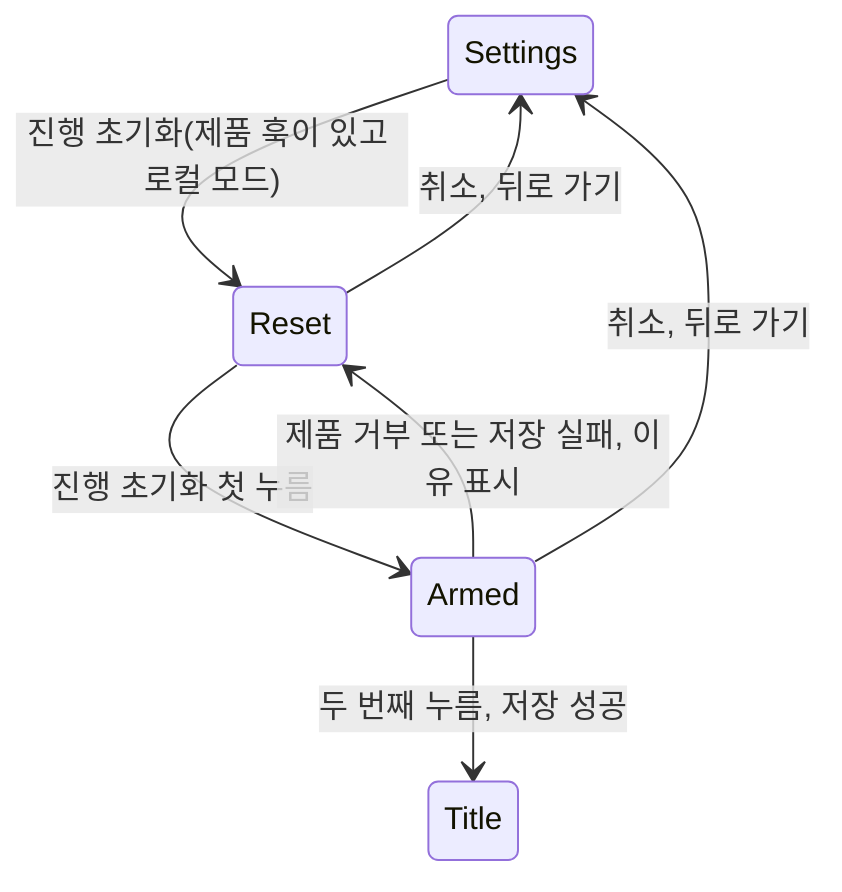

# 진행 초기화와 베타 아틀리에 공용 수정 반영 (계약 1.3.0)

- 설계 ID·기준 커밋: `2026-11-28-progress-reset`, 기준 main `4071d7be7ff6d4f11e3fd043bd6e4b05146fff05`
- 상태: 승인. 2026-11-28 사용자가 betta-raising의 게임 제작 체계 v2 갭 정리 계획에서 "데이터 초기화는 공용 묶음에 추가"를 고르고 계획을 승인했다.
- 테스트 계획: [test-plan.json](test-plan.json). L3(공통 묶음 `addons/**`), 개발 환경, redesign(새 화면 1개), 출시 없음(`release: null`), 기기 사용 없음
- 상위 기준: agent-config `skills/game-planning-production/references/game-completeness.md`의 CMP-04(설정의 데이터 초기화, 담당 game-foundation 설정)와 CMP-05(초기화 때 남기는 필드)

## 목적·범위·근거

완성작 구성요소 CMP-04는 설정에 데이터 초기화를 요구하고 담당을 game-foundation 설정으로 둔다. 1.2.0 설정에는 초기화가 없어서 게임마다 따로 만들어야 했다. 이 변경은 설정에 "진행 초기화"를 더하고, 제품이 자기 저장 키를 같은 쓰기 안에서 정리하는 훅을 연다.

같은 PR에서 betta-raising이 로컬 브랜치(`feature/betta-v013-mail-labels`, 원격에 없는 `8a38c27`)로만 쓰던 공용 수정 여섯 개를 원본으로 옮긴다. 공통 수정은 원본에서 하고 검수한 묶음을 설치한다는 규칙과 어긋난 상태를 끝내기 위해서다.

| 구분 | 내용 |
|---|---|
| 포함 | `flow/state.gd`의 `reset_progress`, `flow/outgame_main.gd`의 설정 항목·초기화 화면·`progress_reset` 훅·`progress_was_reset` 신호, 레퍼런스 제품 훅, 베타 공용 수정(우편 보상 이름 제공자, 작은 가로 보상 카드, E2E 드라이버 오디오 해제 대기와 스크롤 안정 판정, 입력 배치 검사), 계약 1.3.0 |
| 제외 | 서버 계정 저장의 초기화(계정 탈퇴가 맡는다), 소비 게임 설치(betta-raising 다음 PR), starter-template-game 갱신, 마켓 출시, 기기 사용 |

## 사용자 흐름·화면 상태



| 화면 | 상태와 입력 |
|---|---|
| 설정 | 제품이 `progress_reset`을 정했고 `services.mode == "local"`일 때만 크레딧·테스트실 다음에 "진행 초기화"가 있다. 파괴적인 항목이라 목록 아래쪽에 둔다 |
| 진행 초기화 | 위에서부터 되돌릴 수 없다는 안내, (거부 뒤) 이유, 진행 초기화와 취소 버튼(가로에서는 한 줄), 남는 것(설정, 언어, 이미 본 시작 장면, 복원할 수 있는 구매), 제품 안내(`progress_reset_notes`). 첫 누름은 버튼을 주 버튼 판과 "한 번 더 누르면 초기화해요"로 바꾸기만 하고 저장을 바꾸지 않는다. 무장 뒤 0.6초 안의 둘째 누름은 무시한다(습관적 두 번 누름 방지). 화면을 다시 그리면 무장이 풀린다 |
| 성공 | 저장을 확정한 뒤 `progress_was_reset`을 한 번 보내고, 토스트를 띄우고, 이동 기록을 비운 채 타이틀로 간다. 시작하면 안내(튜토리얼)부터 다시 한다 |
| 실패 | 제품이 거부하거나 제품 결과가 저장 검사에 맞지 않으면 "초기화하지 못했어요. 바뀐 것은 없어요"를 토스트로 알리고, 같은 화면을 무장 없이 다시 그려 경고 문장 바로 아래에 같은 이유를 둔다. 저장 바이트는 그대로다 |

## 데이터·인터페이스·실패 처리

```text
state.reset_progress(product := Callable()) -> bool
  next = defaults()에서 시작하고 아래만 previous에서 옮긴다
    settings, consentVersion, events(보낸 분석 사건의 중복 방지), intro_seen(참일 때), ui.commerce(구매 진행 기록)
  product(previous, next) -> Dictionary: 제품이 자기 키를 정리하고 남길 값을 옮긴 next. 사전이 아니거나 비면 error = "reset_refused"
  commit(next): 공용 스키마 검사와 원자적 쓰기. 실패하면 data와 파일은 그대로

outgame_main
  progress_reset: Callable(previous, next) -> Dictionary
  progress_reset_notes: Array[[en, ko]]
  signal progress_was_reset
  mail_reward_name_provider: Callable(entitlementId) -> String   # 빈 문자열이면 "보상"
reward_ceremony.present(items): item.compact가 참이면 아이콘 44px과 글자를 한 줄로 놓는다
```

- 한 번의 쓰기: 베타처럼 제품 저장이 공용 저장 파일 안의 키(`betta_atelier`)에 있으면 공용과 제품을 따로 지울 때 중간 실패로 반쪽 초기화가 남는다. 그래서 제품 훅이 next를 고쳐 돌려주고 공용이 한 번에 확정한다.
- 남기는 필드: 설정과 동의 버전은 사용자가 고른 값이다. `events`를 비우면 이미 보낸 첫 시작 같은 사건이 다시 나갈 수 있다. `intro_seen`은 CMP-05 예시대로 남긴다. `ui.commerce`에는 확인 중인 구매가 있을 수 있어 지우면 지급이 끊긴다. 우편은 로컬 예제 우편으로 돌아가고 `grants`는 비워 새 진행에서 안내 보상을 다시 받을 수 있다.
- 서버 모드: 서버 계정 진행은 이 기기만 지워도 다시 내려받으므로 항목을 보이지 않는다. 계정 탈퇴가 그 역할을 한다.
- 메모리 상태: 공용은 저장과 화면만 되돌린다. 제품은 `progress_was_reset`에서 메모리의 진행과 `set_ending_seen`을 새 저장에 맞춘다. 레퍼런스는 엔딩 본 기록을 메모리에만 두므로 `set_ending_seen(false)`로 지운다.

## 품질 요구사항

- 기존 흐름 무변경: 훅이 없는 제품의 설정은 1.2.0과 같다. 기존 여정과 probe는 그대로 통과한다.
- 화면: 초기화 화면이 390x844, 320x568, 844x390, 1280x720에서 잘리지 않고 글자가 읽힌다. 새 버튼은 공용 `_button`을 써서 가로 화면에서 56px 이상이다.
- 하위 호환: 1.3.0 묶음은 1.0.0~1.2.0 위에 설치되고 반대는 거부한다. 저장 버전(`SAVE_VERSION` 3)을 올리지 않는다. 제품 skin.json 계약은 1.1.0 그대로다.
- 베타 공용 수정: 우편 카드는 제품 이름을 쓰고 ID를 드러내지 않는다. 작은 가로 카드는 기본 카드를 바꾸지 않는다.

## 대안·주요 결정

| 결정 | 고른 것 | 고르지 않은 것과 이유 |
|---|---|---|
| 확인 방식 | 같은 버튼 두 번 누르기(테스트실 덮어쓰기와 같은 방식, 무장하면 주 버튼 판), 둘째 누름은 0.6초 뒤부터 | 확인 팝업: 공용 팝업 큐와 순서가 얽히고, 테스트실과 다른 확인 문법이 생긴다 |
| 위치 | 설정 목록 아래쪽(크레딧·테스트실 다음) | "계정과 저장" 화면 안: 가로·계정 포트가 있는 게임은 별도 계정 패널(`account_panel`)을 열어 같은 항목을 두 곳에 만들어야 한다 |
| 제품 연결 | `progress_reset(previous, next)`가 next를 돌려주고 공용이 한 번에 쓴다 | 공용 초기화 뒤 제품이 따로 쓰기: 두 번째 쓰기가 실패하면 반쪽 초기화가 남는다 |
| 노출 조건 | 제품 훅 + 로컬 모드 | 늘 노출: 제품 저장 키를 모르는 공용 초기화는 제품 진행을 남긴 채 공용만 지운다 |
| 계약 버전 | 1.3.0 | 1.2.0 유지: 같은 버전 이름 아래 파일 집합과 API가 달라져 소비 게임이 어떤 기능이 있는지 판단할 수 없다 |

## 인수조건·테스트·검수

| 조건 ID | 통과 기준 | 방법·환경 | 시작 상태 | 증거 |
|---|---|---|---|---|
| PR-1 | 첫 누름은 무장만 하고 저장이 같다. 취소하면 설정으로 돌아가고 저장이 같다. 다시 열면 무장이 풀려 있다 | 여정 `settings-reset-progress` | 진행이 있는 격리 저장 | `journey.json`, 캡처 |
| PR-2 | 제품 거부나 잘못된 값은 저장을 바꾸지 않고 이유를 보여 주며 무장을 푼다. 제품 훅 없이도 공용만 초기화할 수 있다(API) | 여정 + `outgame_contract_probe` | 격리 저장 | `journey.json`, probe 로그 |
| PR-3 | 성공하면 코인·안내·홈 레벨이 처음으로, 설정·`intro_seen`·`ui.commerce`·제품이 고른 키는 남고 다른 제품 키는 지워지며 저장 버전이 같다. 신호가 한 번 오고 타이틀에서 시작하면 안내부터다 | 여정, 다시 읽은 저장 | 격리 저장 | `journey.json` |
| PR-4 | 서버 모드와 훅이 없는 제품은 항목이 없다 | 여정 | 격리 저장 | `journey.json` |
| PR-5 | 우편 보상 이름 제공자와 빈 이름의 "보상", 작은 가로 카드(가로 줄, 44px 아이콘)와 기본 카드 유지 | 여정 `late-server-response-preserves-navigation`, `ui_kit_probe` | fixture | `journey.json`, `ui-kit.json` |
| PR-6 | 1.3.0이 1.2.0 위에 설치되고 반대는 거부된다. 1.3.0 아래 skin 계약 1.1.0이 통과한다 | `tools/test_bundle.py`, `tools/test_ui_contract.py` | 임시 폴더 | 테스트 로그 |
| PR-7 | 초기화 화면(영어·한국어)이 네 크기에서 잘리지 않고 읽힌다 | `check.py --capture --size` 390x844, 320x568, 844x390, 1280x720 + 독립 검수 3회 | 레퍼런스 | 캡처, `docs/qa/progress-reset-review/round-N.md` |

- TDD: 구현 전에 `outgame_contract_probe`의 초기화 검사가 `reset_progress` 없음으로 실패하고, 버전 테스트 3개가 1.2.0 때문에 실패하는 것을 확인한 뒤 구현했다.
- 베타 수정의 원래 근거: 오디오 해제와 스크롤 안정 판정은 betta-raising v0.1.3 검수에서 재현한 E2E 드라이버 실패를 고친 것이다(`docs/design/2026-11-11-input-layout/design.md`).

## 독립 검수

| 회차 | 후보 | 판정 | 주요 지적과 처리 |
|---|---|---|---|
| 1 | `1afbf05` | fail | 거부 이유가 버튼 아래에 붙어 가로에서 안 보임(R1-1, major), 두 번 연타로 확인 문구 전에 확정(R1-2, major). 이유를 버튼 위와 토스트로, 0.6초 확인 지연, 무장 판 변경(R1-3), 가로 한 줄 버튼(R1-4), 남는 것 문구(R1-5), 거부 문구(R1-6), 입력 배치 설계 문서(R1-8)를 반영 |

기록은 `docs/qa/progress-reset-review/round-N.md`다.

## 적용·운영·되돌리기

1. 이 PR → 독립 검수 3회 → 병합 → 잠금 원본 커밋을 main 병합 커밋으로 맞추는 후속 PR.
2. agent-config `skills/game-ui-design/references/godot-kit.md`의 검수 고정 커밋을 갱신한다. starter-template-game은 4071d7b(1.2.0)에 그대로 둔다.
3. 소비 게임: betta-raising이 자기 `tools/bundle.py`와 `tools/validate_outgame.py` 사본을 1.3.0으로 갱신하고 묶음을 설치한 뒤 `progress_reset`을 연결한다.
4. 되돌리기: 이 PR을 revert하면 1.2.0으로 돌아간다. 저장 형식을 바꾸지 않으므로 1.2.0 빌드도 초기화된 저장을 연다.
5. 검수 캡처 원본은 `build/` 아래에만 만들고 NAS1dual로 옮긴 뒤 저장소에는 요약과 위치만 남긴다.
